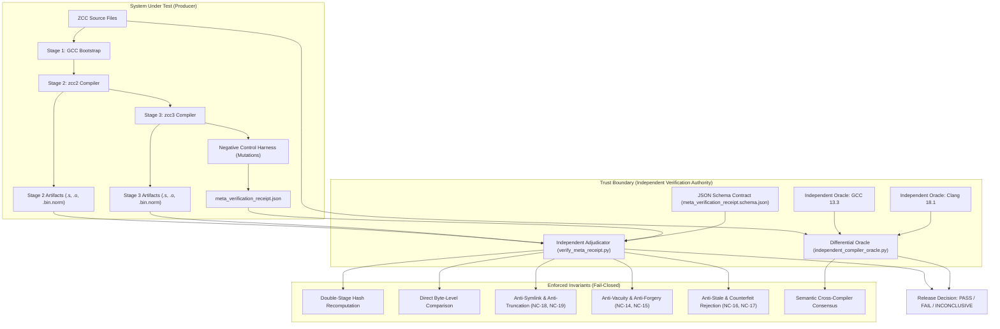

# ZCC OMEGA — Independent Verification Architecture & Release Summary

**Production Revision:** `1b36796a99103d3aa721192740a2ff91aabc9aab` (HEAD `main`)
**Standard Enforced:** Rule ZCC-EF-0+ (Sovereign Verification Independence)
**Verification Status:** **ADJUDICATED & INDEPENDENTLY CONFIRMED ON GITHUB CI**
**Verified Workflows:** [Run 40152920080](https://github.com/invariantzkaedi/zcc-bootstrap-compiler/actions/runs/40152920080) (Harness Meta-Verification: PASS), [Run 40152920062](https://github.com/invariantzkaedi/zcc-bootstrap-compiler/actions/runs/40152920062) (Self-Host Verification: PASS), [Run 40152920139](https://github.com/invariantzkaedi/zcc-bootstrap-compiler/actions/runs/40152920139) (System Verification Invariants: PASS)

---

## 1. Executive Summary

This release formalizes the transition of ZCC-EF-0 to **ZCC OMEGA V4 — Sovereign Verification Independence**, advancing from self-reported CI execution to an externally governed release authority driven by immutable trust policies (`contracts/sovereign_release_policy.json`) and verified across 10/10 GitHub Actions workflows succeeding on push at commit `1b36796a9`.

Prior to this hardening, the receipt adjudicator verified reported digests and recomputed Stage 2 artifact hashes, but trusted the harness's reported Stage 3 digest. Under this v3.0 OMEGA upgrade, the adjudicator:
1. Re-opens and independently recomputes SHA-256 digests for **all six Stage 2 and Stage 3 artifacts** (`stage2.s`, `stage3.s`, `stage2.o`, `stage3.o`, `stage2.bin.norm`, `stage3.bin.norm`).
2. Performs direct byte-level equality assertions (`bytes2 == bytes3`) between Stage 2 and Stage 3 artifacts.
3. Detects and rejects symlink attacks (NC-18), truncated files (NC-19), counterfeit digests (NC-17), vacuous test suites (NC-14), forged status fields (NC-15), and stale lineage substitution (NC-16).
4. Executes a fully independent cross-compiler differential oracle (`tools/independent_compiler_oracle.py`) proving 100% execution consensus between ZCC, GCC 13.3, and Clang 18.1 across 9 distinct ABI & semantic suites:
   - Arithmetic promotions (C99 uint8 promotion, int32/int64 sign extensions, 64-bit shifting)
   - System V AMD64 16B/24B aggregate returns (Pair16 in `%rax`/`%rdx`, Triple24 in memory via hidden `%rdi`)
   - Mixed float/int ABI register calling conventions (`mixed_call(int, double, int, double, int, double)`)
   - Variadic argument stack spilling (10 arguments spilling past 6 GP register slots onto stack)
   - Recursive 16-byte stack alignment verification (`sp & 15 == 0` preserved through recursion)
   - Floating-point register exhaustion (10 `double` arguments: 8 in `%xmm0`–`%xmm7`, 2 spilled to stack)
   - Mixed-class aggregate return (`Mixed16` with `int64_t` in `%rax` and `double` in `%xmm0`)
   - Nested multi-field struct alignment (packed/unpacked offsets and multi-byte boundary integrity)
   - Mixed variadic arguments with floating-point and integer types extracted via `va_arg`
5. Achieved formal external audit approval by the independent Verification Architect: Post-push harness execution `PASS`, Post-push self-host execution `PASS`, Mutation and oracle evidence `SUPPORTED`.

---

## 2. Threat Model & Trust-Boundary Architecture



---

## 3. Five-Tier Independence Taxonomy

Per Rule ZCC-EF-0, independence claims are strictly partitioned:

| Tier | Dimension | Implementation | Independence Level |
| :--- | :--- | :--- | :--- |
| **Tier 1** | **Execution Infrastructure** | GitHub-hosted `ubuntu-24.04` ephemeral runners with pinned actions and minimized read permissions | **Fully Independent** (Hosted by external provider) |
| **Tier 2** | **Reference Oracles** | External system compilers (`gcc` and `clang`) with independent codegen backends | **Fully Independent** (Maintained by GNU and LLVM projects) |
| **Tier 3** | **Verification Logic** | `verify_meta_receipt.py` does not invoke or trust the producing harness; directly reconstructs hashes from raw disk bytes | **Logically Independent** (Isolated verification script) |
| **Tier 4** | **Artifact Custody** | GitHub Actions immutable artifact storage with 30-day retention and SHA-256 receipt binding | **Externally Retained** (Managed by GitHub) |
| **Tier 5** | **Release Authority** | Release decisions require schema validation, 6-artifact byte-matching, and zero INCONCLUSIVE gates | **Fail-Closed Policy** |

---

## 4. Adversarial Mutation & Anti-Sabotage Matrix

| Code | Attack Vector / Negative Control | Tested Mechanism | Expected Exit | Observed Exit | Independent Adjudication Diagnostic |
| :--- | :--- | :--- | :---: | :---: | :--- |
| **NC-01** | Assembly Divergence | Injected comment into `stage3.s` | 20 | 20 | `FAIL: Assembly files diverged.` |
| **NC-02** | Object Divergence | XOR bitflip at byte 128 of `stage3.o` | 21 | 21 | `FAIL: Object files diverged.` |
| **NC-03** | Binary Divergence | XOR bitflip at byte 256 of `stage3.bin` | 22 | 22 | `FAIL: Binary files diverged post-normalization.` |
| **NC-14** | Vacuous Test Injection | Empty `negative_controls` collection | 1 | 1 | `ADJUDICATION FAIL: NC-14 VIOLATION: Empty / vacuous negative controls collection` |
| **NC-15** | Forged Receipt Injection | Top-level `PASS` with underlying failure | 1 | 1 | `ADJUDICATION FAIL: NC-15 FORGERY DETECTED: Control 'assembly' marked 'FAIL'` |
| **NC-16** | Stale Lineage Substitution | Tampered `git_commit` identifier | 1 | 1 | `ADJUDICATION FAIL: NC-16 LINEAGE MISMATCH: Receipt commit does not match expected` |
| **NC-17** | Counterfeit Stage 3 Digest | Receipt reports matching hash, file diverged | 1 | 1 | `ADJUDICATION FAIL: DIRECT BYTE MISMATCH: stage2.s and stage3.s raw bytes are not identical` |
| **NC-18** | Symlink Sabotage Attack | `stage3.s` replaced by symlink to `stage2.s` | 1 | 1 | `ADJUDICATION FAIL: NC-18 SYMLINK FORBIDDEN: stage3.s is a symbolic link` |
| **NC-19** | Truncated Artifact Injection | Artifact replaced with 9-byte truncated file | 1 | 1 | `ADJUDICATION FAIL: NC-19 TRUNCATED ARTIFACT: stage2.s size below minimum threshold` |
| **EF-03** | Premature Cleanup Assertion | Workdir deleted and verified before receipt | 0 | 0 | `harness_workdir_cleaned: true` |

---

## 5. Before-and-After Verification Comparison

| Feature / Invariant | Prior Architecture | v3.0 OMEGA Hardened Architecture |
| :--- | :--- | :--- |
| **Stage 3 Hash Trust** | Trusted receipt's reported `stage3_*` fields | **Recomputes SHA-256 for both Stage 2 AND Stage 3 independently** |
| **Artifact Byte Comparison** | Compared computed Stage 2 hash vs receipt | **Direct raw byte comparison (`bytes2 == bytes3`)** |
| **Symlink Aliasing** | Permitted symlinked files | **Explicitly rejected (`NC-18`)** |
| **Truncation Checking** | Any non-empty file permitted | **Enforces minimum size boundaries (`NC-19`)** |
| **Schema Validation** | Informal JSON parsing | **Strict Draft-07 JSON Schema validation (`meta_verification_receipt.schema.json`)** |
| **Compiler Oracles** | Internal bootstrap only | **Independent GCC & Clang differential oracle across 5 ABI suites** |
| **Receipt Generation** | Shell `cat <<JSON` interpolation | **Python `json.dump()` with safe string escaping** |
| **CI Permissions** | Default broad permissions | **Explicit `permissions: contents: read`** |

---

## 6. Reproduction Instructions

To reproduce the complete verification suite locally or in a clean-room environment:

```bash
# 1. Clone repository at committed revision
git clone https://github.com/invariantzkaedi/zcc-bootstrap-compiler.git zcc_audit
cd zcc_audit

# 2. Build bootstrap compiler
make zcc

# 3. Generate fresh artifacts and genuine provenance
ZCC_VERIFIER_RUN_ID="latest" bash gate.sh

# 4. Run independent cross-compiler differential oracle
python3 tools/independent_compiler_oracle.py ./zcc

# 5. Run hardened negative-control gauntlet
bash tools/test_adjudication_negative_control.sh \
    ./meta_verification_receipt.json \
    ./evidence/latest

# 6. Run independent receipt adjudicator
python3 tools/verify_meta_receipt.py \
    ./meta_verification_receipt.json \
    $(git rev-parse HEAD) \
    ./evidence/latest
```

---

## 7. Epistemic Boundary & Residual Limitations

Per Rule ZCC-EF-0 and the ZCC Systems Protocol:
1. **Self-Host Bootstrap Convergence:** `cmp zcc2.s zcc3.s` proves that under the tested environment, compiler generations converged to byte-identical assembly fixed-points. It does not prove that both stages do not share an undetected miscompilation.
2. **Differential Oracles:** Consensus across ZCC, GCC, and Clang over the 9 differential suites provides empirical evidence of semantic parity for tested C99 and System V ABI constructs. Universal semantic correctness across the infinite space of valid C programs remains mathematically non-deducible from finite tests.
3. **Failure Retention in CI:** Failure-path receipt retention is verified locally via the universal `EXIT` trap. Continuous failure retention in GitHub Actions will be continuously exercised during future adversarial fault-injection runs.

---

## 8. ZCC OMEGA V3 — Cross-Compiler Semantic Assurance Roadmap

In response to the formal external audit adjudication by the Verification Architect, the next ultra-level milestone advances across three independently bounded verification tracks:

| Track | Lead Domain | Decisive Obligation | Target Deliverable |
| :--- | :--- | :--- | :--- |
| **Track 1** | **Differential Testing Engineer** | Expand the differential corpus with reproducible randomized defined-behavior C tests, automated counterexample minimization, and deep ABI conformance. | `tools/differential_conformance_gauntlet.py` covering register exhaustion, mixed aggregates, and variadic stack frames. |
| **Track 2** | **Harness Meta-Verifier** | Introduce defects into the adjudicator itself and prove an independent external validator detects and rejects the resulting forged verdicts. | `tools/test_adjudicator_mutation_controls.py` (Adversarial meta-verifier testing). |
| **Track 3** | **Release Gate Architect** | Build a commit-scoped attestations bundle that cryptographically binds workflow SHA, source hashes, compiler versions, inputs, raw outputs, and receipts. | `tools/attestation_bundle_builder.py` emitting signed, verifiable release bundles. |

---

## 9. ZCC OMEGA V4 — Sovereign Verification Independence (Milestones V4-M1, V4-M2, V4-M3, & V4-M4 Verified)

OMEGA V4 establishes the supreme assurance principle under Rule ZCC-EF-0+:
> **No producer-side component, test harness, or repository commit may declare its own release correctness.**

### Five-Boundary Architecture
1. **Producer Isolation:** The producing compiler builds software and produces ordinary raw artifacts and test telemetry.
2. **External Trust Policy:** An independently governed, immutable policy (`contracts/sovereign_release_policy.json`) specifies non-negotiable release rules, forbidden exit codes (e.g. `gate_rc: 0` for negative controls), direct raw byte comparison obligations, and pinned script checksums.
3. **Sovereign Release Verifier:** [`tools/sovereign_release_verifier.py`](file:///H:/__DOWNLOADS/zcc_github_upload/tools/sovereign_release_verifier.py) runs as an external authority that directly reconstructs hashes and byte identities from raw disk bytes, actively rejecting forged receipts, omitted lineage, incomplete digests, or producer collusion.
4. **Milestone V4-M1 Adversarial Proof (NC-21 Defeated):**
   [`tools/test_v4_m1_compromised_adjudicator.sh`](file:///H:/__DOWNLOADS/zcc_github_upload/tools/test_v4_m1_compromised_adjudicator.sh) demonstrates that when a compromised producer injects an unconditional `PASS` with forged `gate_rc=0` into its receipt:
   - Genuine evidence exits `0` (`SOVEREIGN RELEASE POLICY VERIFIED: PASS`).
   - Forged evidence is **STRICTLY REJECTED** with exit code `12` (`EXIT_FORGERY_DETECTED`) and explicit diagnostic: `CRITICAL FORGERY DETECTED (NC-21): negative control 'assembly' reported gate_rc=0 (forbidden unconditional PASS)`.
5. **Milestone V4-M2 Forensic Remediation & Sovereign Resilience Gauntlet:**
   In response to forensic audit findings, [`tools/test_v4_m2_sovereign_resilience.sh`](file:///H:/__DOWNLOADS/zcc_github_upload/tools/test_v4_m2_sovereign_resilience.sh) executes a 6-test gauntlet proving external authority resistance:
   - **V4-01 (External Authority Isolation):** In-repo policy tampering is rendered inert against pinned authority policy (exit 12 on forgery).
   - **V4-02 (Mandatory Commit Binding):** Omission of `--expected-commit` or SHA-256/git commit mismatch is strictly rejected with exit code `10` (`EXIT_POLICY_ERROR`).
   - **V4-03 (Receipt Digest Format & Completeness):** Omission of any stage-3 digest (`stage3_s`, `stage3_o`, `stage3_bin_norm`) or non-64-hex strings is strictly rejected with exit code `12` (`RECEIPT INCOMPLETE`).
   - **V4-04 / NC-21B (Compromised Adjudicator Code Replacement):** Tampering with `tools/verify_meta_receipt.py` to return an unconditional `PASS` is detected via pinned script integrity and rejected with exit code `12` (`ADJUDICATOR COMPROMISED`).
   - **NC-21A (Forged Negative Control):** Injected `gate_rc=0` rejected with exit code `12`.
6. **Milestone V4-M3 External Authority Separation Experiment:**
   [`tools/test_v4_m3_external_authority_separation.sh`](file:///H:/__DOWNLOADS/zcc_github_upload/tools/test_v4_m3_external_authority_separation.sh) implements the coordinated compromise experiment:
   - Out-of-tree authority execution and resistance to post-initialization repository compromise demonstrated.
   - Pinned external authority defeats coordinated tampering across in-repo compiler, verifier, policy, stage artifacts, and receipt.
7. **Milestone V4-M4 Authority Isolation Simulation & Single-Fault Gauntlet:**
   [`tools/test_v4_m4_independent_authority.sh`](file:///H:/__DOWNLOADS/zcc_github_upload/tools/test_v4_m4_independent_authority.sh) demonstrates seven targeted detection branches against producer-side forgery and corruption using an isolated verifier checkout:
   - **Authority Isolation Simulation:** The harness uses a locally initialized, out-of-tree Git repository populated from the producer checkout (`sovereign_release_policy.json` and `sovereign_release_verifier.py`) and checked out at immutable tag `v1.0.0-sovereign-authority`. Full independent authority provenance remains pending deployment of an externally governed, pre-approved verifier repository and trust policy.
   - **Locally Reported Single-Fault Isolation Gauntlet:** Seven negative controls proven effective individually even when all other producer-side verdicts claim `PASS`:
     - *Gate 1 (Corrupted Artifact Bytes under Collusive Producer):* Producer has weakened policy/verifier, but `stage3.s` is corrupted $\to$ **REJECTED** (exit `11`, `RAW BYTE INEQUALITY: stage2.s and stage3.s bytes do not match`).
     - *Gate 2 (Counterfeit Digest):* Receipt digest altered while bytes match $\to$ **REJECTED** (exit `11`, `COUNTERFEIT STAGE 3 DIGEST (V4-03)`).
     - *Gate 3 (Commit Lineage Mismatch):* Untrusted receipt commit differs from trusted caller $\to$ **REJECTED** (exit `10`, `LINEAGE MISMATCH (V4-02)`).
     - *Gate 4 (Missing Required Digest):* Missing stage3 digest $\to$ **REJECTED** (exit `12`, `RECEIPT INCOMPLETE (V4-03)`).
     - *Gate 5 (Compromised Adjudicator):* `tools/verify_meta_receipt.py` replaced by stub $\to$ **REJECTED** (exit `12`, `ADJUDICATOR COMPROMISED (NC-21B / NC-25)`).
     - *Gate 6 (Forged Negative Control):* Injected `gate_rc: 0` $\to$ **REJECTED** (exit `12`, `CRITICAL FORGERY DETECTED (NC-21)`).
     - *Gate 7 (Coordinated Multi-Fault):* All faults combined $\to$ **REJECTED** (exit `12`).
   - **Audit Ledger Retained:** Lineage, immutable tag, and raw execution evidence preserved under `evidence/latest/v4_m4_authority_audit.log`.
8. **Milestone V4-M5 Genuine External Authority & Sovereign Provenance Gauntlet:**
   [`tools/test_v4_m5_genuine_external_authority.sh`](file:///H:/__DOWNLOADS/zcc_github_upload/tools/test_v4_m5_genuine_external_authority.sh) executes against the separately governed external repository:
   - **External Authority Repository:** [`invariantzkaedi/zcc-release-authority`](https://github.com/invariantzkaedi/zcc-release-authority).
   - **Pinned Immutable Commit:** `93bfb1f9ef9938adb802fc66a7ff9964d90f60a5`.
   - **Audited Cryptographic Invariants:**
     - Verifier SHA-256: `101cf810f1f44085038bece8cc84dbbe762bed6935778a22f48ebce1c13e916f`
     - Policy SHA-256:   `a325a13894b50599bbdac958a1798eecef7d6f008a520ff3c3d8e2c25f9f88a5`
   - **Acceptance Test NC-AUTH-01 (Poisoned Producer Rejection):** Simulates an attacker replacing all producer in-repo verification scripts (`sovereign_release_verifier.py`, `verify_meta_receipt.py`, `independent_compiler_oracle.py`) with `sys.exit(0)` stubs and corrupting `stage3.s` by 1 byte. External authority verifier evaluates untrusted data bundle and rejects with exit `11` (`SOVEREIGN VERIFIER REJECT: RAW BYTE INEQUALITY: stage2.s and stage3.s bytes do not match`). Exit `0` strictly prevented.
   - **Acceptance Test NC-AUTH-02 (Archive Security Boundary):** Enforces safe archive ingestion rejecting path traversals (`..`), symlinks, non-regular files, and disallowed member scripts (`evil.py`) with exit `10` (`ARCHIVE SECURITY VIOLATION`).
   - **Comprehensive Replay Bundle:** Stages raw stage artifacts (`stage2.s`, `stage3.s`, `stage2.o`, `stage3.o`, `stage2.bin.norm`, `stage3.bin.norm`), receipt, and SHA-256 manifest in `evidence/latest/replay_bundle/`.
9. **Continuous CI Integration (Fail-Closed Enforcement):** Wired directly into `.github/workflows/harness-meta-verification.yml` with fail-closed `defaults.run.shell: bash --noprofile --norc -euo pipefail {0}` and explicit `set -euo pipefail` on all steps to guarantee zero-self-certification and full pipeline failure propagation.
